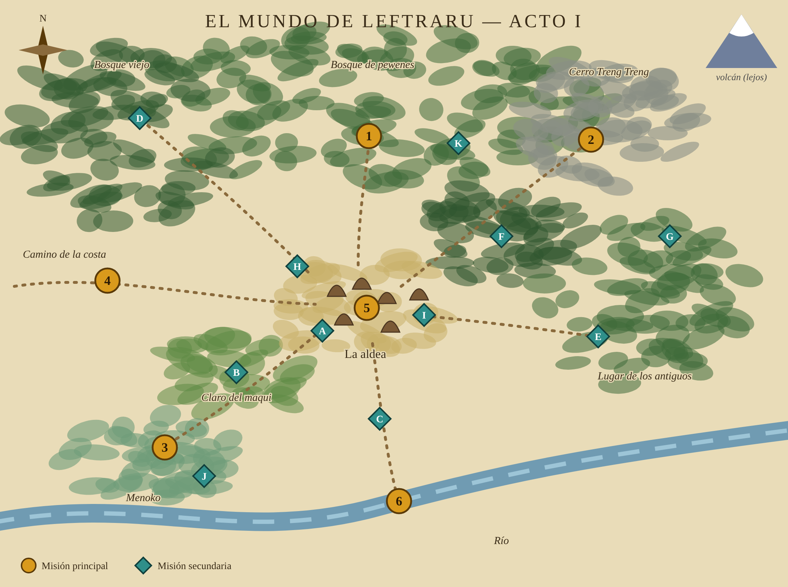

# Acto I — El mundo de Leftraru

Guion de trabajo (borrador 3). Un acto de **inmersión**: Leftraru es un niño querido y curioso que recorre su aldea y su bosque. No hay españoles ni drama de "no encajar". El jugador conoce el mundo mapuche conversando, explorando y escuchando historias.

**Lugar y fecha:** tierras de Nahuelbuta, días previos al We Tripantu (año nuevo), invierno de 1545.
**Protagonista:** Leftraru ("traro veloz"), 11 años.

---

## 1. Cómo funciona

- **Un mapa pequeño y abierto.** La aldea al centro; alrededor, el bosque, el cerro, el humedal y el río. Todo se alcanza caminando en pocos minutos.
- **La historia es lineal.** Las misiones principales (1 a 6) siguen la preparación del We Tripantu y van en orden: cada una se abre al terminar la anterior, y la persona con quien sigue la historia lleva una estrella dorada sobre la cabeza.
- **Los encargos son libres.** Las misiones secundarias son opcionales y no tienen orden. No están a la vista desde el comienzo: se consiguen conversando con la gente de la aldea, y cada persona encarga las suyas.
- **Cómo empieza:** en la portada, «Entrar al mundo» lleva a «Historia». El capítulo 1 parte con un prólogo: una hoja escrita que va pasando y se aleja, y que cuenta dónde estamos, quién es Leftraru y qué se está preparando. Termina con su madre llamándolo.
- **Se aprende jugando:** la primera conversación con Millaray enseña a moverse, hablar, observar (el telar), ayudar con las manos (la lana) y leer una misión. Cada paso queda escrito arriba hasta que se cumple.
- **Sin presión:** nada tiene tiempo límite ni se puede fallar. Lo que mueve al jugador es la curiosidad.
- **El mapa se va pintando:** al inicio es un pergamino casi vacío. Cada lugar visitado aparece dibujado, y los puntos de interés se marcan cuando alguien los menciona en una conversación.

**Mirar:** la acción propia de Leftraru. Al mantener un botón se queda quieto y observa. Así aprende de los animales, descubre detalles y, a veces, ve cosas que los demás no ven.

**Lo místico:** se muestra de verdad, pero solo lo ven Leftraru y el jugador, y nunca queda del todo claro si fue real. Los adultos hablan de los espíritus con naturalidad, como parte del mundo.

---

## 2. Personajes

| Personaje | Quién es | Dónde está |
|---|---|---|
| **Curiñancu** | Su padre, lonko (jefe). Tranquilo; enseña haciendo, no hablando. | Bosque de pewenes, aldea |
| **Millaray** | Su madre, tejedora. Práctica y de humor seco. | Telar, en la aldea |
| **La abuela (kuku)** | Sabe todas las historias. | Fogón; lugar de los antiguos |
| **Ayelén** | Su hermana de 6 años. Lo sigue y pregunta todo. | Lo acompaña por la aldea |
| **Rayen** | 12 años, su mejor amiga. Rápida y burlona. | Cancha, río, bosque viejo |
| **Nahuel** | Su primo mayor, 14 años. Le enseña la honda. | Cancha |
| **La machi** | Sanadora y autoridad espiritual. | Su ruka; el menoko |
| **Ñamku** | El más anciano; guarda la memoria del pueblo. | Su ruka |
| **Antü** | Werkén (mensajero) que llega con los invitados. | Camino de la costa |
| **Kürüf** | La weke (llama) joven y arisca de la familia. | Corral |

Todos son ficticios salvo Leftraru y el nombre de su padre, que viene de la tradición.

---

## 3. La historia: misiones principales

### El arco

La pregunta que mueve el capítulo es sencilla: **¿qué tiene que aprender un niño para que su gente pueda contar con él?** Leftraru parte como el que "se queda mirando pájaros" y termina siendo alguien en quien la aldea confía. Cada misión lo saca un poco más lejos de la ruka y le pide un poco más.

| Momento | Misión | Quién la da | Qué se abre con ella | Qué cambia en Leftraru |
|---|---|---|---|---|
| **Planteamiento** | 1 · Los piñones del pewen | Millaray, su madre | El bosque de pewenes | Le dan un encargo de niño y lo cumple. Aprende a pedir antes de tomar. |
| **Planteamiento** | 2 · El traro | Curiñancu, su padre | El cerro Treng Treng | Ve su mundo entero por primera vez y entiende su nombre: mirar es su fuerza. |
| **Nudo** | 3 · Las plantas de la machi | La machi | El monte soleado, el claro del maqui, el lugar de los antiguos | Por primera vez alguien depende de él: Ñamku está enfermo. Ya no es un mandado, es un cuidado. |
| **Nudo** | 4 · Los invitados | Ñamku (ya sano) y Rayen | El camino de la costa | El mundo es más grande que la aldea: recibe a gente de afuera en nombre de los suyos. |
| **Clímax** | 5 · La noche de las historias | La abuela | El fogón, de noche | Escucha la memoria de su pueblo, incluida la de los incas: ya una vez vinieron extraños a mandar. |
| **Cierre** | 6 · We Tripantu | Toda la aldea | La poza del río, al alba | Recibe el año nuevo con todos. El mundo está entero… por última vez. |

**Cómo se encadenan:** al entregar los piñones, Millaray lo manda con su padre; en la cima, Curiñancu le avisa que Ñamku enfermó y que la machi lo busca; al sanar, Ñamku le anuncia que vienen los de la costa; los invitados traen la noche larga, y la noche termina en el río. Ninguna misión aparece antes de tiempo.

**Lo que el jugador sabe y Leftraru no:** el relato de entrada dice que al norte llegaron hombres extraños y que la historia lo llamará Lautaro. Nadie en la aldea habla de eso. Esa distancia es la que le da peso al cierre.

### 1 — Los piñones del pewen *(jugable)*
**Lugar:** la aldea y el bosque de pewenes. **Con:** Millaray.
Su madre lo llama desde el telar. Antes de mandarlo al bosque le pide dos cosas que sirven de tutorial: mirar bien el telar y alcanzarle la lana. Después viene el encargo: vienen los parientes de la costa y los piñones no alcanzan. Hay que ir al bosque del norte, recoger los que quedan (uno está sobre unas rocas) y **volver a entregárselos**. Al tomar el último, una escena breve lo muestra agradeciendo al pewen y a su madre esperándolo en la aldea.
- **Enseña:** moverse, saltar, conversar, recoger.
- **Muestra:** el pewen como árbol que alimenta; la costumbre de no sacudirlo.
- **Enlace:** Millaray le dice que su padre subió al Treng Treng y preguntó por él.
> MILLARAY: Recoge los que cayeron solos: no sacudas el árbol, que él decide cuánto da.

### 2 — El traro *(jugable)*
**Lugar:** cerro Treng Treng. **Con:** Curiñancu.
Curiñancu lo lleva al cerro: va adelante por el sendero, a su paso, le cuenta cosas mientras suben y lo espera si se queda atrás. Arriba se paran juntos y, en una escena, le muestra el valle y el mar, el volcán, y le explica por qué se llama como el traro.
- **Enseña:** trepar y **mirar**.
- **Muestra:** todo su mundo desde arriba, en una escena breve.
- **Enlace:** el padre le avisa que Ñamku amaneció con fiebre y que la machi lo anda buscando.
> CURIÑANCU: El que va a cuidar a su gente tiene que aprender a mirar así: primero todo, después lo suyo.

### 3 — Las plantas de la machi *(jugable)*
**Lugar:** el rewe, el monte soleado, el claro del maqui. **Con:** la machi y Ñamku.
La machi ya no puede andar por el monte: Leftraru será sus pies. Reúne hojas de canelo, corteza de quillay y hojas de maqui, vuelve con ella y le lleva el lawen a Ñamku.
- **Enseña:** reconocer plantas y usar la tecla de acción.
- **Muestra:** que lo que sana no es solo la planta, sino que alguien fue a buscarla pensando en el enfermo.
- **Enlace:** Ñamku, ya con el remedio, le anuncia que vienen los de la costa.
> MACHI: Antes de cortar, pide. Di para quién es. La planta que se saca sin permiso no sana a nadie.

### 4 — Los invitados *(por hacer)*
**Lugar:** camino de la costa. **Con:** Antü y Rayen.
Llegan familias de la costa para celebrar juntos. Leftraru y Rayen salen a recibirlos y los guían a la aldea.
- **Muestra:** que los pueblos de la costa y del cerro se visitaban e intercambiaban: ellos traen algas y pescado seco, la aldea ofrece los piñones que él mismo recogió.
- **Historia:** un niño de la costa cuenta sobre el *Shumpall*, el espíritu que vive en el agua.

### 5 — La noche de las historias *(por hacer)*
**Lugar:** el fogón. **Con:** todos.
La noche más larga del año. Nadie duerme: se come, se conversa y se cuentan historias hasta el alba. El jugador elige a quién escuchar.
- **Historias:** *el regalo del pewen* (la abuela), *la memoria de los incas* (Ñamku), y las que el jugador haya ido encontrando en sus encargos.
- **Muestra:** que la historia y el saber se pasaban hablando, de mayores a niños.

### 6 — We Tripantu *(por hacer)*
**Lugar:** el río. **Con:** toda la aldea.
Antes del alba todos bajan al río a bañarse para recibir el año nuevo. Amanece sobre el volcán. El traro cruza el cielo.
- **Cierre del acto:** la cámara se aleja sobre el bosque. El mundo está entero.

---

## 4. Encargos: misiones secundarias

Son opcionales y se pueden hacer en cualquier orden. **Aparecen en la lista cuando la persona te los encarga**: unos al conocerla, otros al volver a conversar con ella (esas personas llevan un rombo celeste). Los que ya están en el juego:

| Quién | Encargo | Qué pide |
|---|---|---|
| **Millaray** | Conoce a tu gente | Conversar con las siete personas de la aldea. |
| | Manos que ayudan | Alcanzarle la lana, traer agua a la olla y dar pasto a los weke. |
| | El amarillo de la manta | Dos raíces de michay para teñir. |
| **Curiñancu** | El bosque tiene nombres | Observar pewen, coigüe, roble, canelo y el árbol abuelo. |
| | Hojas para el curanto | Dos tallos de nalca (cuando ya conoces la planta). |
| **La abuela** | Lo que se cuenta junto al fuego | Aprender las siete historias y creencias. |
| | Junto al fuego | Sentarse un rato en los troncos del fogón. |
| | Murtilla para la kuku | Tres puñados de murtilla. |
| **Ayelén** | Los que vuelan y los que corren | Observar weke, pudú, traro, choroyes y rayaditos. A las aves se las observa posadas. |
| | Huellas chicas | Encontrar huellas de pudú y seguirlas hasta verlo. |
| **Rayen** | Los caminos del valle | Recorrer los diez lugares del territorio. |
| | A dos rayas | Jugar un palin en la cancha. |
| **La machi** | Pedir permiso | Saludar al entrar al bosque viejo, al menoko y al lugar de los antiguos. |
| | Plantas del suelo | Observar helecho, juncos, flores, maqui, quila y copihue. |
| **Ñamku** | La casa y el fuego | Observar la ruka, el fogón, el rewe, el telar y las figuras de madera. |
| | El monte soleado | Observar peumo, boldo, quillay y litre. |

### Ideas para más adelante

#### Familia
- **Kürüf** (corral). La weke joven no se deja guiar. Mirándola, Leftraru entiende qué la asusta y se gana su confianza. *Muestra: el animal doméstico de la época, antes de los caballos.*
- **El lugar de los antiguos** (al oriente). La abuela lo lleva hasta el borde del lugar donde descansan los antepasados y le habla de su abuelo. *No se entra: se mira desde lejos, con respeto.*
- **Ayelén y las escondidas** (aldea, sin marcador). Su hermana se esconde en distintos rincones; encontrarla hace recorrer toda la aldea.

#### Rayen
- **La carrera al río.** Rayen lo reta a correr hasta el agua. Gane o pierda, terminan conversando en la orilla sobre qué quieren ser de grandes.
- **El escondite** (bosque viejo). Rayen le muestra su lugar secreto: un árbol hueco enorme. Hacen una promesa.
- **La honda.** Nahuel le enseña a usarla en la cancha.

#### El bosque y lo místico
- **El canto del chucao.** Se oye un chucao en el bosque espeso. Según por qué lado cante, anuncia buena o mala suerte en el camino. Hay que encontrarlo mirando.
- **Las huellas del nawel.** Huellas grandes en el barro. Siguiéndolas, Leftraru ve por un instante al puma entre los árboles. No hay peligro: solo dos que se miran. *Nahuelbuta lleva en su nombre al gran felino.*
- **Las luces del menoko.** De noche, pequeñas luces se mueven sobre el humedal. Si las sigue, llega a un claro donde no hay nadie. La machi, al oírlo, solo sonríe.
- **El zorro.** Un zorro lo lleva por un sendero oculto. Al contarlo, la abuela responde con un *epew*: el cuento del zorro que se cree más listo que todos.

#### Memoria
- **La memoria de Ñamku** (su ruka). El anciano cuenta cómo, en tiempos de su padre, los ejércitos del inca llegaron desde el norte y no pudieron pasar. Le entrega un objeto pequeño de esa época.

---

## 5. Lo que se colecciona

Como su pueblo no usaba escritura, lo aprendido se guarda como imágenes pintadas:

- **Historias** (7): Treng Treng y Kai Kai, el regalo del pewen, el Shumpall, el epew del zorro, la memoria de los incas, el chucao, las luces.
- **Animales** (6): traro, pudú, zorro, chucao, puma, weke.
- **Plantas** (6): pewen, canelo, maqui, y tres medicinales.
- **Personas:** cada personaje se completa al terminar su historia.

---

## 6. Cuidado de época

Todavía no existían aquí caballos, ovejas, trigo, hierro ni platería. Los animales domésticos son el weke y el perro; se cultiva maíz, papa y quínoa.

**Pendiente importante:** antes de cerrar el guion conviene que alguien con conocimiento de la cultura mapuche revise nombres, palabras en mapudungun, los relatos y cómo mostramos lo espiritual y los lugares sagrados. Varias costumbres las conocemos por descripciones posteriores a 1545.

---

## 7. Orden de construcción sugerido

1. Mapa ampliado con la aldea y los senderos, y el mapa en pantalla que se va pintando.
2. Sistema de conversaciones y de misiones.
3. Misiones 1 y 2 (ya hay base en el prototipo) más la secundaria A.
4. El resto, zona por zona.

## 8. Decisiones tomadas

1. **Idioma:** español con palabras en mapudungun.
2. **Última línea:** el acto termina con el texto *"Fue el último We Tripantu que Leftraru pasó en su casa."*
3. **Día y noche:** el momento del día cambia al completar misiones principales.

## 9. Interfaz

- **Minimapa** (abajo a la izquierda): el jugador al centro con una flecha que indica hacia dónde camina; los objetivos fuera de vista se marcan en el borde.
- **Notas** (abajo a la derecha, tecla N): todo lo descubierto, separado en Mitología, Personajes y Naturaleza. Cada nota es una hoja con imagen y descripción.
- **Bolsa** (abajo a la derecha, tecla B): lo que Leftraru va encontrando.
